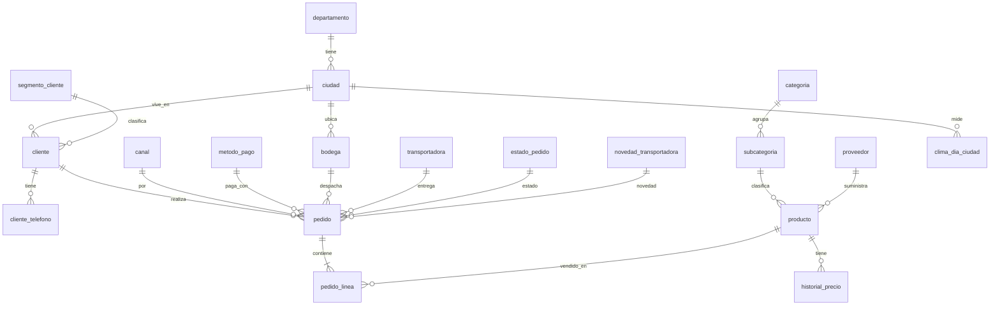

# Parte 1 · Modelo relacional normalizado (1FN → 2FN → 3FN)

Caso MercaLlano. Base de datos `MercaLlano` en SQL Server, esquemas `stg`, `oltp` y `dw`. Este documento cubre el esquema **oltp**.

## 0. Qué datos hay

| Archivo | Qué es | Tamaño |
|---|---|---|
| `pedidos_raw.csv` | Una fila por línea de pedido, con cliente, bodega, transportadora, producto y entrega mezclados | 14.777 filas × 34 columnas |
| `catalogo_productos.xlsx` | Hoja `productos` (maestro con proveedor) y hoja `historial_precios` (precio con vigencia) | 53 y 123 filas |
| `novedades_viales.json` | Un registro por día con lluvia por ciudad y estado de la vía Bogotá–Villavicencio | 546 días |

En el CSV hay 2.900 pedidos, 1.134 clientes y 55 SKU.

## 1. Primera forma normal (1FN)

**Regla:** cada celda guarda un solo valor, cada fila se puede identificar y cada columna tiene un solo formato.

### Violaciones encontradas

| # | Violación | Dónde | Ejemplo real |
|---|---|---|---|
| 1 | Varios valores en una celda | `pedidos_raw.cliente_telefonos` | Cliente 1019223012: `3103666184 / 3235501800 / 6086268695`. En 2.598 filas hay varios números separados por `/` |
| 2 | Filas repetidas, sin identificador | `pedidos_raw` | La pareja (`id_pedido`, `linea`) aparece repetida en 175 filas que son copias exactas. Ej.: `PED-00017` línea 3 (SKU-3007, $4.200, cantidad 10, descuento 0.05) dos veces |
| 3 | Formatos mezclados en una columna | `precio_unitario` | `22900` y `$17.900` |
| 3 | idem | `descuento` | `0`, `0%`, `0.05`, `5%`, `0.10`, `10%` y 2.964 vacíos |
| 3 | idem | `fecha_pedido` | `2025-01-01 07:03:04` y `02/01/2025 16:08` (día/mes/año) |
| 4 | Estructura anidada (lista dentro de un registro) | `novedades_viales.json` | Cada día trae una lista `ciudades[]` de 14 ciudades |

### Tablas resultantes en 1FN

| Tabla | Columnas | Llave primaria |
|---|---|---|
| `pedidos_linea` | todas las columnas del CSV, con tipos únicos (precio numérico, descuento de 0 a 1, fechas ISO) | (`id_pedido`, `linea`) |
| `cliente_telefono` | `cliente_documento`, `telefono` | (`cliente_documento`, `telefono`) |
| `productos` | columnas de la hoja `productos` | `sku` |
| `historial_precios` | `sku`, `vigente_desde`, `vigente_hasta`, `precio_lista` | (`sku`, `vigente_desde`) |
| `clima_dia_ciudad` | `fecha`, `ciudad`, `lluvia_mm`, `alerta` | (`fecha`, `ciudad`) |
| `via_estado_dia` | `fecha`, `estado`, `horas_restriccion` | `fecha` |

Cómo queda el caso de los teléfonos:

| cliente_documento | telefono |
|---|---|
| 1019223012 | 3103666184 |
| 1019223012 | 3235501800 |
| 1019223012 | 6086268695 |

Las 175 copias exactas se descartan: quedan 14.777 − 175 = **14.602** filas distintas. No se borran en silencio: van a `stg.rechazos` con el motivo.

## 2. Segunda forma normal (2FN)

**Regla:** estar en 1FN y, si la llave tiene dos columnas, cada dato debe depender de **toda** la llave, no de una parte.

La llave de `pedidos_linea` es (`id_pedido`, `linea`). Hay datos que dependen solo de `id_pedido` (son del pedido completo, no de la línea) y otros que dependen solo de `sku`.

| Dato | Depende solo de | Evidencia |
|---|---|---|
| `fecha_pedido`, `fecha_entrega_prometida`, `fecha_entrega_real`, `estado_pedido`, `canal`, cliente, bodega, transportadora | `id_pedido` | `PED-00001` tiene 4 líneas y las cuatro repiten fecha prometida `2025-01-02` y transportadora "Rápido Llanero S.A.S." |
| `producto`, `categoria`, `refrigerado`, `peso_unitario_kg` | `sku` | `SKU-1001` aparece 281 veces, escrito de dos formas: "Leche entera bolsa 1 L" (252) y "LECHE ENTERA BOLSA 1 L" (29) |

### Tablas resultantes en 2FN

| Tabla | Contiene | Llave primaria |
|---|---|---|
| `pedido` | datos del pedido completo (fechas, estado, canal, cliente, bodega, transportadora, distancia) | `id_pedido` |
| `pedido_linea` | `sku`, `cantidad`, `precio_unitario`, `descuento` | (`id_pedido`, `linea`) |
| `producto` | nombre, categoría, peso, refrigerado | `sku` |
| `historial_precio` | precio de lista con vigencia | (`sku`, `vigente_desde`) |
| `cliente_telefono`, `clima_dia_ciudad`, `via_estado_dia` | igual que en 1FN | igual que en 1FN |

`cantidad`, `descuento` y `precio_unitario` se quedan en la línea porque son lo que se cobró en esa línea.

## 3. Tercera forma normal (3FN)

**Regla:** estar en 2FN y que ningún dato dependa de otro dato que no sea la llave ("la llave, toda la llave y nada más que la llave").

| Dato que arrastra a otros | Ejemplo real | Tabla nueva |
|---|---|---|
| cliente → nombre, email, ciudad, segmento | El documento 1019223012 siempre es Lina Valentina Medina Rey, Villavicencio, segmento Hogar. Se repite en cada línea (14.777 filas para 1.134 clientes) | `cliente` |
| ciudad → departamento | Villavicencio → Meta; Yopal → Casanare; Chía → Cundinamarca | `ciudad`, `departamento` |
| bodega → nombre y ciudad | BOD-01 → Bodega Central Villavicencio; BOD-02 → Bodega Fontibón (Bogotá); BOD-03 → Bodega Yopal | `bodega` |
| transportadora → NIT | "LogiExpress Colombia S.A.S." → 900.445.566-1 (también escrito 900445566-1 y 900445566) | `transportadora` |
| producto → subcategoría → categoría | Hortalizas → Frutas y verduras | `subcategoria`, `categoria` |
| proveedor (NIT) → nombre, ciudad, teléfono | 900.981.402-7 → Agrocentro del Ariari Ltda., Granada. Se repite en 11 productos | `proveedor` |
| Listas cortas de texto libre | canal, método de pago, estado del pedido, segmento, novedad de la transportadora | una tabla pequeña para cada una |

Un cliente se mudó: 13 clientes tienen pedidos en dos ciudades. Ejemplo: el documento `1006016988` (Marcela Vargas Baquero) recibía en Villavicencio y desde 2026-05-31 en Bogotá. Por eso `cliente` guarda la dirección **actual** y `pedido` guarda la `direccion_entrega` y la `ciudad_entrega_id` de **ese** pedido.

### Tablas finales en 3FN: 20 tablas del esquema `oltp`

| Grupo | Tabla | Llave primaria | Llaves foráneas / UNIQUE |
|---|---|---|---|
| Dónde | `departamento` | `departamento_id` | |
| | `ciudad` | `ciudad_id` | FK `departamento_id` |
| | `bodega` | `bodega_id` | FK `ciudad_id`; UNIQUE `codigo` |
| Listas cortas | `segmento_cliente` | `segmento_id` | Hogar, Restaurante, Tienda |
| | `canal` | `canal_id` | Web, App, WhatsApp, Teléfono |
| | `metodo_pago` | `metodo_pago_id` | |
| | `estado_pedido` | `estado_id` | Entregado, Devuelto, Cancelado, Anulado |
| | `novedad_transportadora` | `novedad_id` | |
| Personas y empresas | `cliente` | `cliente_id` (IDENTITY) | FK segmento, ciudad; UNIQUE `documento` |
| | `cliente_telefono` | (`cliente_id`, `telefono`) | FK `cliente_id` |
| | `transportadora` | `transportadora_id` | UNIQUE nombre y nit |
| | `proveedor` | `proveedor_id` | FK ciudad; UNIQUE nit |
| Productos | `categoria` | `categoria_id` | |
| | `subcategoria` | `subcategoria_id` | FK `categoria_id` |
| | `producto` | `producto_id` | FK subcategoría, proveedor; UNIQUE `sku` |
| | `historial_precio` | (`producto_id`, `vigente_desde`) | FK `producto_id` |
| Corazón | `pedido` | `pedido_id` (IDENTITY) | UNIQUE `codigo_pedido`; FK cliente, canal, método de pago, bodega, transportadora, estado, ciudad de entrega, novedad |
| | `pedido_linea` | (`pedido_id`, `linea`) | FK `pedido_id`, `producto_id`; `venta_neta` es columna calculada |
| Contexto diario | `via_estado_dia` | `fecha` | |
| | `clima_dia_ciudad` | (`fecha`, `ciudad_id`) | FK `ciudad_id` |

## 4. Diagrama entidad-relación

Resumen de las relaciones principales (1 → N). El diagrama completo en imagen está en `diagrama_er.png` (y `diagrama_er.dbml` para dbdiagram.io).

## 5. Decisiones y supuestos

- **Llave primaria artificial (`cliente_id`, `pedido_id`) en vez de la cédula o `PED-00001`:** un entero autoincremental ocupa poco, no cambia y hace los joins más rápidos. El dato real se protege con `UNIQUE` (`documento`, `codigo_pedido`).
- **`cliente` guarda la dirección actual;** `pedido` guarda la dirección y ciudad de entrega de ese día, porque los clientes se mudan (13 casos).
- **Los 3 SKU del CSV que no están en el catálogo** (`SKU-9001`, `SKU-9002`, `SKU-9003`; 87 filas) sí se cargan, con `en_catalogo = 0` y costo y proveedor vacíos. Así no se pierden ventas.
- **`SKU-3004` está repetido en el catálogo** con dos costos (2.820 y 3.160). Se deja una fila y se anota el rechazo. *Supuesto a confirmar con Compras.*
- **`franja_entrega`** solo tiene 3 valores (Mañana, Tarde, Noche): se controla con un `CHECK`, sin tabla extra.
- **Precios con $** y fechas en dos formatos se unifican en el ETL (Parte 3).

El script de creación de las tablas está en `ddl_oltp.sql` (esta misma carpeta).
