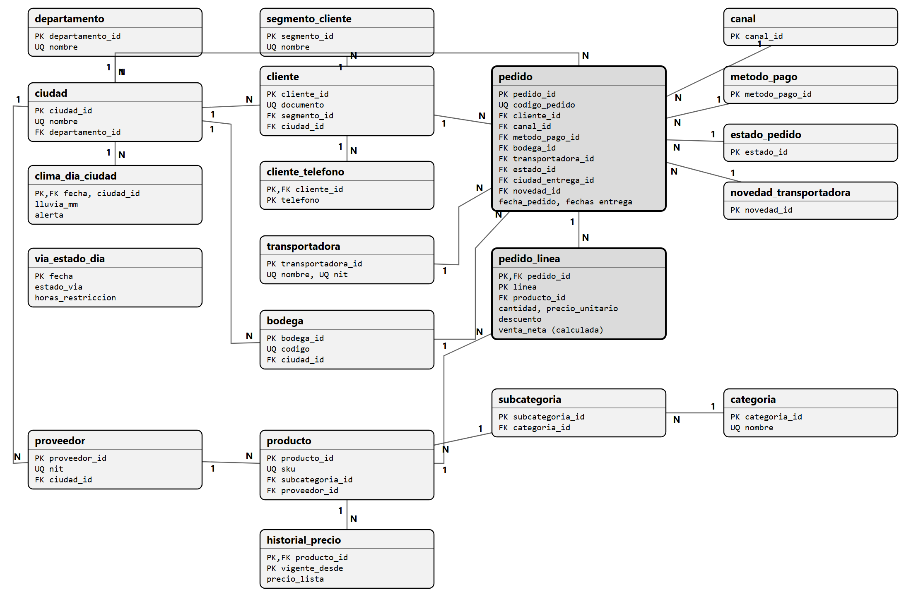
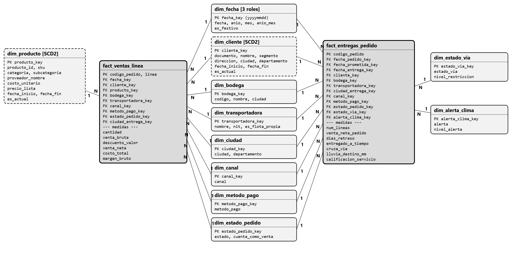
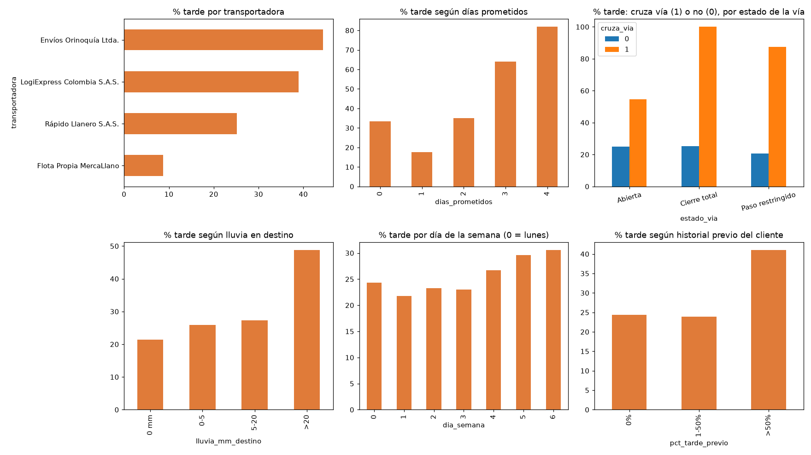
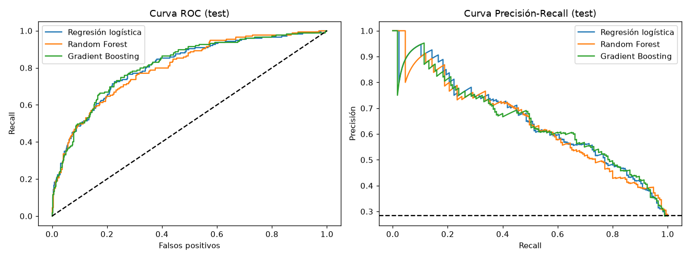

# Prueba técnica · MercaLlano S.A.S.

**Candidata:** Isabella · **Fecha:** 27 de octubre de 2026

Armé la solución de punta a punta: la base en SQL Server, el ETL en Python, las 8 consultas y el modelo de machine learning. Todo corrió en mi equipo y los resultados de abajo salen de esa corrida.

## Qué hay en cada carpeta

| Carpeta | Contenido |
|---|---|
| `01_normalizacion/` | `normalizacion.md` (1FN → 2FN → 3FN con ejemplos reales), `diagrama_er.png` (y `.dbml`), `ddl_oltp.sql` |
| `02_dimensional/` | `modelo_dimensional.md` (grano, medidas, SCD2), `diagrama_estrella.png`, `ddl_dw.sql` |
| `03_etl/` | `etl.py`, `reglas_calidad.md`, `requirements.txt` y lo que genera cada corrida (`rechazos.csv`, `conciliacion.json`) |
| `04_sql/` | `consultas.sql` con las 8 preguntas |
| `05_ml/` | `modelo_entregas_tardias.ipynb` (ejecutado), `dataset_ml.csv` y `vw_dataset_ml.sql` |
| `datos_crudos/` | Los 3 archivos originales, sin tocar |

## Herramientas

SQL Server 2025 Express (instancia `.\SQLEXPRESS`), Python 3.12 con pandas y pyodbc, y scikit-learn para el modelo. Las versiones exactas están en `03_etl/requirements.txt`.

**¿Por qué Python y no SSIS?** Porque la limpieza tiene muchas reglas pequeñas (fechas en dos formatos, 46 formas de escribir una ciudad, precios con `$`...) y en código quedan escritas, se pueden leer y se repiten igual cada vez. Además se corre con un solo comando.

## Cómo ejecutarlo

Desde la carpeta del proyecto:

```bash
# 1. Crear la base y las tablas (en este orden)
sqlcmd -S .\SQLEXPRESS -E -I -f 65001 -b -i 01_normalizacion\ddl_oltp.sql
sqlcmd -S .\SQLEXPRESS -E -I -f 65001 -b -i 02_dimensional\ddl_dw.sql

# 2. Cargar todo (stg -> oltp -> dw)
cd 03_etl
pip install -r requirements.txt
python etl.py

# 3. Consultas: abrir 04_sql\consultas.sql en SSMS o Azure Data Studio y ejecutarla
# 4. ML: abrir 05_ml\modelo_entregas_tardias.ipynb en Jupyter o Colab (subir también dataset_ml.csv)
```

El ETL se puede correr las veces que se quiera: el `stg` se vacía y se vuelve a llenar, las tablas `oltp` y las dimensiones se actualizan con `MERGE` y los hechos se reconstruyen. Lo probé dos veces seguidas y los conteos quedaron iguales. Termina con error si la conciliación no cuadra.

## Resultado de la carga

| Concepto | Valor |
|---|---:|
| Filas leídas del CSV | 14.777 |
| Rechazadas (en `stg.rechazos`, con su motivo) | 284 |
| Líneas cargadas en `oltp` y en `dw` | 14.493 |
| Pedidos cargados | 2.895 de 2.900 |
| Venta neta de pedidos Entregado (pandas = oltp = dw) | $1.348.784.235 |

Los 284 rechazos son 175 filas duplicadas, 91 con cantidad negativa o cero, 17 con entrega anterior al pedido y 1 con precio 0 sin precio de lista. El detalle de todas las reglas está en `03_etl/reglas_calidad.md`.

## Diagramas y gráficas

**Modelo normalizado (oltp, 20 tablas):** las flechas 1 y N muestran quién depende de quién; `pedido` y `pedido_linea` son el centro.



**Modelo dimensional (dw):** dos tablas de hechos (ventas por línea y entregas por pedido) rodeadas de sus dimensiones. `dim_cliente` y `dim_producto` son SCD tipo 2.



**Exploración de los datos para el modelo:** cada gráfica compara el porcentaje de pedidos tardíos según una variable (transportadora, días prometidos, vía, lluvia, día de la semana e historial del cliente).



**Curvas de los modelos en el conjunto de prueba:** todos quedan muy por encima del azar (la línea punteada).



## Decisiones principales

- **Dos tablas de hechos**: `fact_ventas_linea` (una fila por línea) y `fact_entregas_pedido` (una fila por pedido), porque ventas y entregas se miran con granos distintos.
- **SCD tipo 2** en `dim_cliente` (13 clientes se mudaron) y en `dim_producto` (cambia el precio de lista). Así la pregunta 3 usa la ciudad donde estaba el cliente al momento del pedido.
- **Llaves enteras** (`cliente_id`, `pedido_id`) y la cédula o `PED-xxxxx` protegidas con `UNIQUE`.
- **Nada se borra en silencio**: lo que no se carga queda en `stg.rechazos` y los conteos por etapa cuadran (14.777 = 284 + 14.493).
- **ML**: se predice si un pedido llega tarde usando solo lo que se sabe al confirmarlo, y se valida separando por fecha (entrenamiento hasta dic-2025, validación ene-feb 2026, prueba desde mar-2026).

## Supuestos

1. Descuento vacío = 0 (sin descuento).
2. Año imposible en la fecha del pedido (2205, 2225, 2226, 3 pedidos): se corrige al año de la fecha prometida.
3. Precio 0: se reemplaza por el precio de lista vigente ese día. Un caso sin precio de lista se rechaza.
4. Cantidad negativa o cero: se rechaza (no se asume que sea una devolución).
5. Los 3 SKU que no están en el catálogo tienen 87 líneas en el CSV: 85 se cargan (2 se rechazan por otras reglas) y 82 son de pedidos Entregado. Se cargan sin costo y la pregunta 6b reporta esas 82 aparte.
6. `SKU-3004` viene repetido en el catálogo con dos costos (2.820 y 3.160): dejé la primera fila. Habría que confirmarlo con Compras.
7. Correos inválidos (121) se dejan vacíos, no los inventé.
8. Reclamo, calificación, distancia y novedad vacíos se dejan en NULL: el dato no existe.
9. Para el modelo uso el reporte de lluvia y de la vía del **día del pedido**. Si ese reporte sale después de confirmar el pedido, habría que usar un pronóstico.

## Resultados del modelo

Cerca de 1 de cada 4 pedidos llega tarde. La regresión logística tuvo PR-AUC 0,65 en prueba (el azar da 0,28) y ROC-AUC 0,81. Con el umbral 0,50 detecta 7 de cada 10 pedidos tardíos y 55 % de sus alertas son acertadas. Lo que más pesa es la distancia, la transportadora y la lluvia en destino. La conclusión completa para el negocio está al final del notebook.
